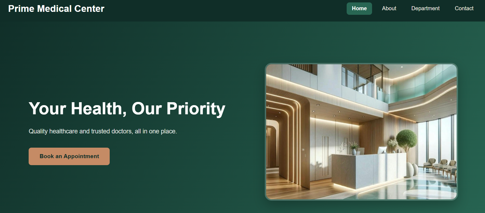
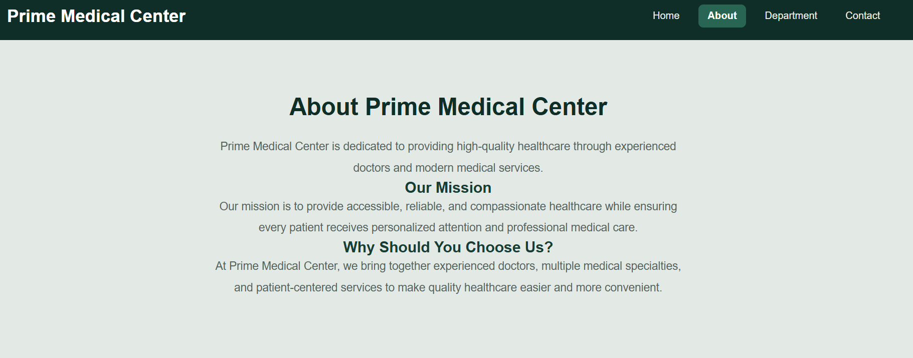
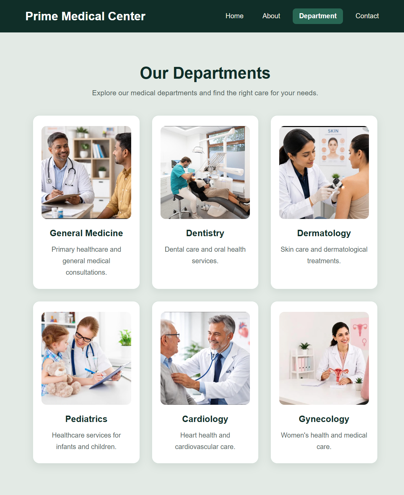
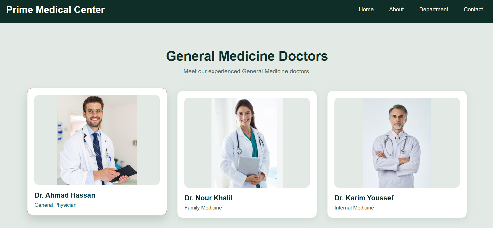
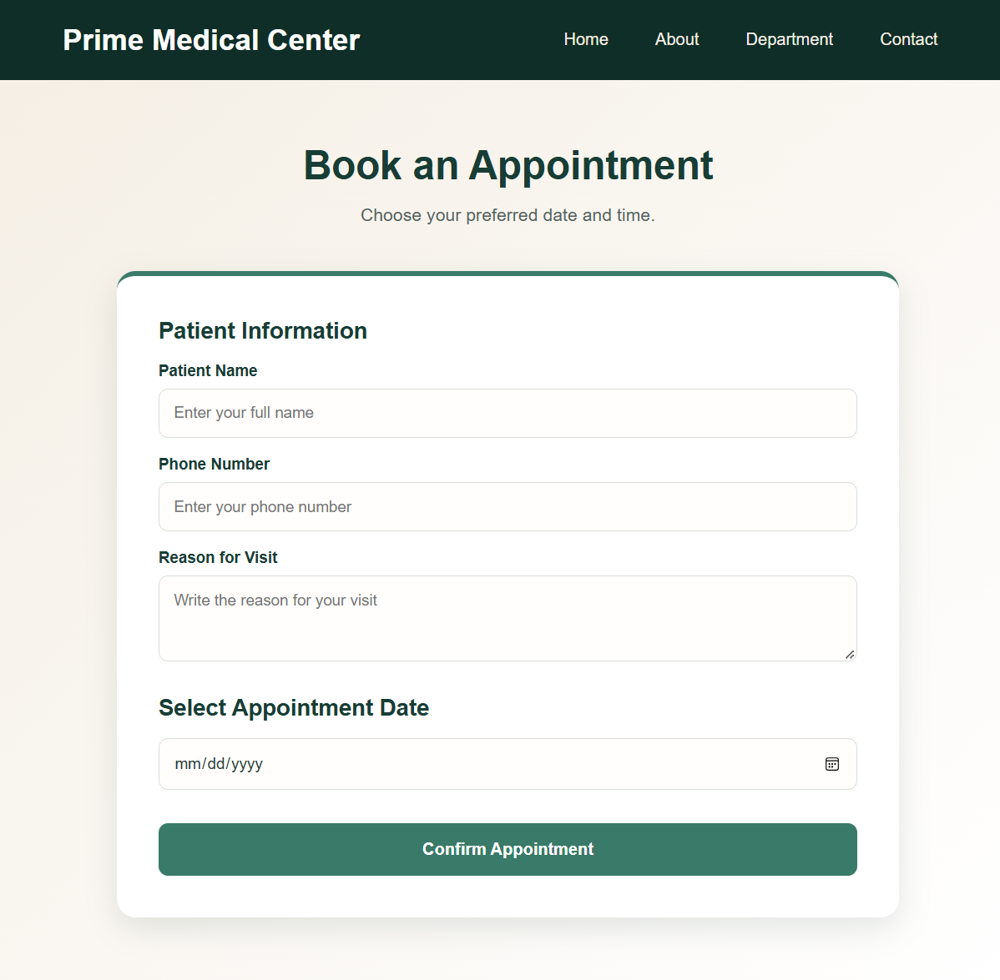
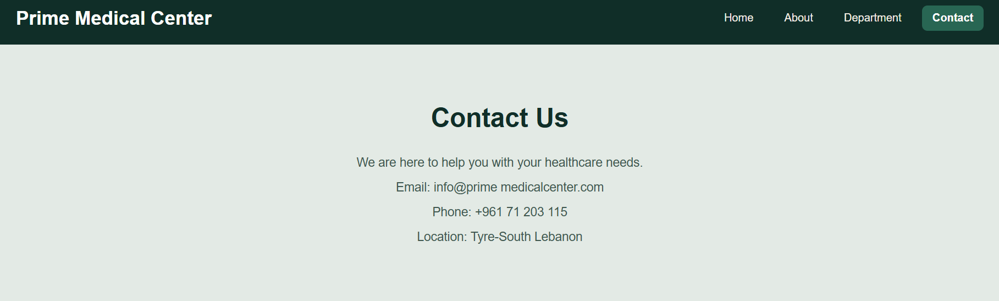

#Prime Medical Center

1. Project Description

Prime Medical Center is a responsive healthcare website developed using React.js as part of the CSCI426 Advanced Web Programming course.

The project aims to provide patients with an easy way to explore medical departments, view available doctors, and book appointments through a simple and user-friendly interface.

The medical center includes six specialties: General Medicine, Dentistry, Dermatology, Pediatrics, Cardiology, and Gynecology.

Main Features

* Home Page: Introduces Prime Medical Center and its healthcare services.
* About Page: Provides information about the center, its mission, and goals.
* Departments Page: Displays the available medical specialties.
* Doctors Pages: Shows the doctors available in each department.
* Booking Page: Allows patients to select a doctor, choose an available date and time, enter their information, and confirm an appointment.
* Contact Page: Displays the center’s contact information.

2. Technologies Used

* React.js
* JavaScript
* HTML5
* CSS3
* React Router
* React Hooks (useState and useContext)
* Context API

3. Setup Instructions

Follow these steps to run the project locally:

1. Clone the repository:
    git clone https://github.com/42330537-svg/Prime-Medical-Center.git
2. Open the project folder:
    cd Prime-Medical-Center
3. Install the required dependencies:
    npm install
4. Start the development server:
    npm start
5. Open your browser and visit:
    http://localhost:3000

4. Appointment Booking

Patients can select a doctor, choose an available appointment date and time, and submit their booking details. The application checks whether a selected time slot has already been booked for that doctor.

Confirmed appointments are managed using React Context and state during the current application session.

5. Future Improvements

* User authentication and login system.
* Database integration.
* Permanent appointment storage.
* Online appointment management.

6. GitHub Repository

[\[Prime Medical Center - GitHub Repository\]](https://github.com/42330537-svg/Prime-Medical-Center.git)

## User Interface Screenshots

### Home Page

### About Page

### Departments Page

### Doctors Page

### Booking Page

### Contact Page
